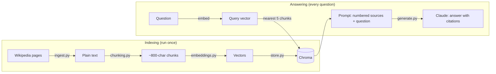

# ⚽ football-rag

A question-answering bot over football Wikipedia articles, built step by step to learn
**Retrieval-Augmented Generation (RAG)** and, more importantly, how to **measure and improve** it.

```text
# Example output (yours will differ slightly)
$ football-rag ask "Who scored the winning goal in the 2014 World Cup final?"

Mario Götze scored the winning goal in extra time as Germany beat Argentina 1–0 [1].

Sources:
  [1] 2014 FIFA World Cup  (similarity 0.82)  https://en.wikipedia.org/wiki/2014_FIFA_World_Cup
```

## How it works



| Step | File | What you learn |
|---|---|---|
| 1. Ingest | `ingest.py` | Getting clean text out of a source, dropping noise |
| 2. Chunk | `chunking.py` | Why we split documents, and how the split changes results |
| 3. Embed | `embeddings.py` | Turning meaning into vectors; query versus document embeddings |
| 4. Store and search | `store.py` | Vector databases, cosine similarity, top-k search |
| 5. Generate | `generate.py` | Grounding Claude in sources, citations, saying "I don't know" |
| 6. Evaluate | `evaluate.py` | Retrieval metrics (hit@k, MRR) and LLM-as-judge answer grading |

## Setup

Needs Python 3.10+ and an [Anthropic API key](https://console.anthropic.com/).

```bash
git clone https://github.com/rahull97/football-rag.git
cd football-rag
python -m venv .venv
source .venv/bin/activate          # Windows: .venv\Scripts\activate
pip install -e ".[dev]"
cp .env.example .env               # then paste your ANTHROPIC_API_KEY into .env
```

## Usage

```bash
football-rag ingest                      # download the ~35 pages in data/pages.txt (1 min)
football-rag index                       # chunk + embed into data/chroma/ (first run downloads a 130 MB model)
football-rag ask "Who managed Leicester when they won the league?"
football-rag ask "..." --show-sources    # also print the retrieved text

football-rag eval --retrieval-only       # free: is search finding the right pages?
football-rag eval                        # full: also grades Claude's answers (~31 questions, a few cents)
pytest                                   # offline unit tests
```

Every evaluation run is saved to `eval/results/` with its settings, so you can compare runs.

## The evaluation set

`eval/questions.jsonl` has 31 questions with reference answers, in three types:

- **single_fact** (24): the answer is in one place. *"Who won the Golden Boot at the 2022 World Cup?"*
- **multi_hop** (4): needs facts from two pages. *"Which club did the manager who won the 2019 Champions League final coach before that team?"*
- **unanswerable** (3): the bot must say it doesn't know, or correct a false premise, instead of making something up. *"Why were Leicester City relegated at the end of the 2015–16 season?"*

## Results log

Change one thing at a time, re-run `football-rag eval`, and record it here.

| # | Change | hit@5 | MRR | Answer score | Single | Multi-hop | Unanswerable |
|---|---|---|---|---|---|---|---|
| 0 | Baseline: 800-char fixed chunks, bge-small, top-5 | | | | | | |

## Experiments to try next

Each is a classic RAG technique. Try them in order and log the numbers above.

1. **Chunk size.** Try `CHUNK_SIZE=400` and `1500` in `.env`. Smaller chunks give more precise matches but less context per chunk.
2. **Contextual chunk headers.** Prefix each chunk with its article title ("Pelé: ..."). Chunks like "He won three titles" lose who "he" is otherwise.
3. **Section-aware chunking.** Split on the `== Heading ==` markers instead of fixed windows.
4. **Hybrid search.** Combine vector search with keyword search (BM25). Embeddings are weak at exact names and numbers like "2016 FA Cup".
5. **Reranking.** Retrieve 20 chunks, then re-score them with a cross-encoder model and keep the best 5.
6. **Multi-hop questions.** Have Claude break a question into sub-questions and retrieve for each one.
7. **Grow the eval set.** 31 questions is a start; 100+ gives scores you can trust.

## Data and licence

Article text comes from [Wikipedia](https://en.wikipedia.org/) under
[CC BY-SA 4.0](https://creativecommons.org/licenses/by-sa/4.0/). Downloaded text is not committed to this repo;
run `football-rag ingest` to fetch it.
