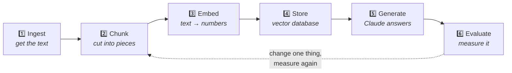
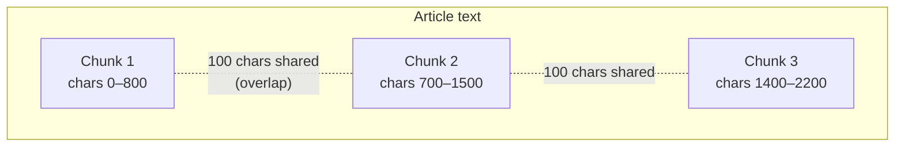
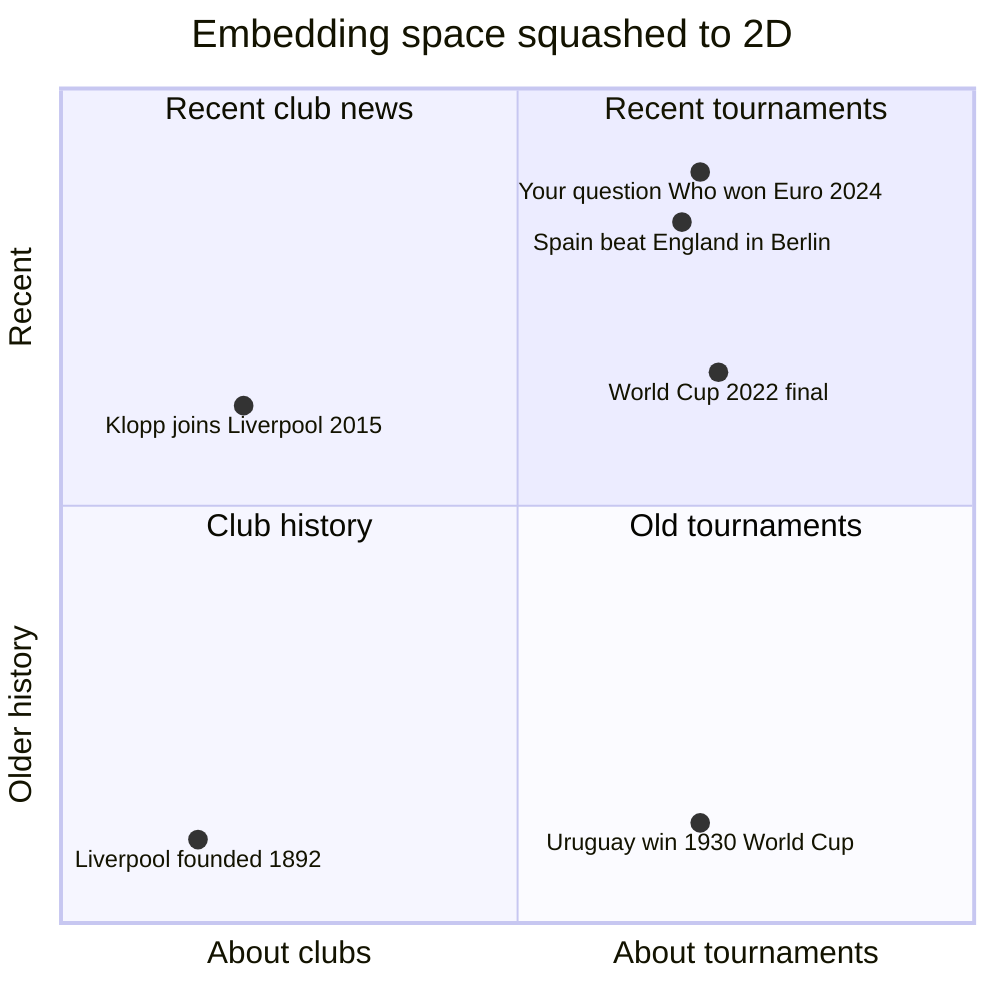
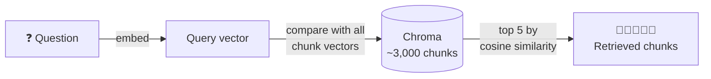
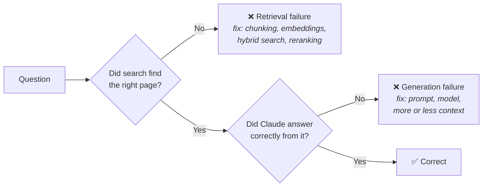

# 🧠 Project 1 concepts: RAG, explained with football

A revision sheet for everything this project teaches. Each concept has a **football analogy**
to make it stick, a **diagram**, and **where it lives in the code**. There's a self-quiz at the end.

---

## The one-line summary

> **RAG = an open-book exam for an LLM.** Instead of trusting what Claude remembers,
> we find the right pages first, hand them over, and ask it to answer *only* from them.

### Memory hook: the six steps

**"I Cut Every Scouting Game Early"**: **I**ngest → **C**hunk → **E**mbed → **S**tore → **G**enerate → **E**valuate



The dotted arrow is the most important part: **RAG is a loop, not a straight line.** You build a
baseline, measure it, change one thing, and measure again.

---

## 0. Why RAG at all?

⚽ **Analogy:** A pundit who's been on holiday for a year will confidently tell you last season's
table, and get it wrong. Hand them today's newspaper and they'll get it right *and* can tell you
where they read it.

LLMs have three problems that RAG fixes:

| Problem | What it means | How RAG fixes it |
|---|---|---|
| **Knowledge cutoff** | The model doesn't know anything after its training date | Fresh documents are retrieved at question time |
| **Hallucination** | It makes up plausible-sounding facts | It's told to answer only from the sources given |
| **No private data** | It has never seen your company's documents | Your documents become the sources |

🆚 **RAG vs fine-tuning (common interview question):** RAG gives the model *knowledge* (facts
that change). Fine-tuning teaches it *behaviour* (style, format, a narrow skill). To add new
facts, use RAG.

---

## 1. Ingestion: getting clean text

⚽ **Analogy:** Before analysing a match you cut out the adverts and the pre-match studio chat.

- We pull plain text from Wikipedia's API, not raw HTML.
- We **drop noise sections** (References, External links, See also). They're full of words that
  match searches but contain no answers.
- **Garbage in, garbage out:** retrieval can only find what ingestion kept.

📍 `src/football_rag/ingest.py`: `fetch_page()`, `clean_text()`

---

## 2. Chunking: cutting text into pieces

⚽ **Analogy:** Nobody rewatches a full 90 minutes to find one goal. You cut the match into
**highlight clips**, and each clip should show the whole goal, not half of it.

**Why chunk?**
1. One vector for a whole article blurs every topic together. Messi's page covers Barcelona,
   PSG, Argentina and Inter Miami, and its single vector would be a muddy average of all four.
2. We can't send every full article to Claude for every question (cost, speed, focus).

**Two settings to remember:**



| Setting | Too small | Too big |
|---|---|---|
| **Chunk size** (800 chars) | Facts lose their context ("He scored twice": who did?) | Matches get vague, and you pay for irrelevant text |
| **Overlap** (100 chars) | A fact on a boundary gets cut in half | Lots of duplicate text |

**Our baseline is deliberately dumb:** fixed-size windows that ignore headings. Smarter chunking
is a planned experiment, and the eval will show how much it helps.

📍 `src/football_rag/chunking.py`: `split_fixed()`

---

## 3. Embeddings: turning meaning into numbers

⚽ **Analogy:** A scout's map where every player is placed by **playing style**. Similar players
end up close together, even if their names, clubs and leagues share nothing.

An **embedding** is a list of numbers (384 of them for `bge-small`) that represents a text's
*meaning*. Texts with similar meaning get similar numbers.



The question lands next to the chunk that answers it, **even though they share almost no
words** ("won" vs "beat"). That's the advantage over keyword search.

**Three details to remember:**
- 🔤 **Same model for questions and documents.** Vectors from different models can't be compared.
- 🏷️ **Query prefix.** BGE models expect `"Represent this sentence for searching relevant passages: "`
  in front of *questions* only. Read your embedding model's instructions.
- 📏 **Normalisation.** We scale every vector to length 1, so similarity depends only on direction.

📍 `src/football_rag/embeddings.py`: `SentenceTransformerEmbedder`

---

## 4. Vector store and similarity search

⚽ **Analogy:** You tell the scout "find me players like *this one*" and they return the
**5 closest** on the map. That's top-k search, with k = 5.

**Cosine similarity** measures the angle between two vectors:

```
            A · B
cos(θ) = ─────────     1.0 = same meaning   0 = unrelated
          |A| |B|
```



- A **vector database** (Chroma here; pgvector, OpenSearch or Pinecone in production) stores the
  vectors and finds nearest neighbours quickly.
- It uses an **approximate** index (HNSW) so it doesn't compare against every single vector.
  The tradeoff: a tiny accuracy loss for a big speed-up.
- **top_k** is a tradeoff: higher k makes it more likely the answer is in there, but adds more
  noise and more tokens.

📍 `src/football_rag/store.py`: `VectorStore.search()`

---

## 5. Generation: grounding Claude in sources

⚽ **Analogy:** The manager's team talk: *"You can **only** pick from these 5 players. Say
which ones you used. If none of them can play the position, tell me. Don't call up someone
from the stands."*

What Claude actually receives:

```text
SYSTEM: Answer ONLY from the numbered sources. Cite like [1].
        If the answer isn't there, say "I don't know based on the available sources."

USER:   <sources>
        [1] (from "UEFA Euro 2024") Spain won the final 2–1 against England in Berlin...
        [2] (from "UEFA Euro 2020") Italy beat England on penalties...
        ...
        </sources>
        Question: Who won Euro 2024?
```

| Prompt technique | Why it matters |
|---|---|
| **"Only use the sources"** | Stops Claude mixing in memory, which may be outdated or wrong |
| **Numbered sources and citations** | Users can verify answers; you can debug which chunk was used |
| **Explicit "I don't know" phrase** | Gives Claude a safe exit instead of guessing. Lowers hallucinations |
| **System prompt for rules, user message for data** | Keeps instructions separate from content |

💰 **Tokens = cost and latency.** Most input tokens are the retrieved chunks, so
`chunk_size × top_k` drives your bill.

📍 `src/football_rag/generate.py`: `SYSTEM_PROMPT`, `generate_answer()`

---

## 6. Evaluation: the part most people skip

⚽ **Analogy:** You don't judge a striker by "they looked good". You check **goals, shots on
target and xG**. Evals are the match stats for your bot.

### Two places it can fail, so two separate scores



**Always check retrieval first.** If the right chunk never arrives, no prompt can save it.

### Retrieval metrics (free, no API calls)

- **hit@k:** did *any* chunk from the right page appear in the top k? Share of questions where it did.
- **MRR (Mean Reciprocal Rank):** *how high up* was the first right result?

| Question | Rank of first right chunk | Reciprocal rank |
|---|---|---|
| Q1 | 1st | 1/1 = **1.0** |
| Q2 | 3rd | 1/3 = **0.33** |
| Q3 | not in top 5 | **0** |
| | **MRR** = average | (1 + 0.33 + 0) / 3 = **0.44** |

### Answer metrics: LLM-as-judge

A second, cheaper Claude model (Haiku) acts as the **referee**: it compares the bot's answer with
our reference answer and rules *correct* (1 point), *partial* (0.5) or *incorrect* (0).

⚠️ Judges can be wrong too. Spot-check their verdicts in `eval/results/` now and then.

### A good test set has different question types

| Type | Example | What it tests |
|---|---|---|
| **Single fact** | "Who won the Golden Boot in 2022?" | Basic retrieval |
| **Multi-hop** | "The 2019 CL-winning manager coached which club before?" | Combining facts from two pages, where simple RAG struggles |
| **Unanswerable** | "Who won the 2034 World Cup?" | Does it admit it doesn't know? |
| **False premise** | "Why were Leicester relegated in 2016?" | Does it push back instead of inventing a reason? |

📍 `src/football_rag/evaluate.py`, `eval/questions.jsonl`

---

## 7. Engineering habits this project shows

| Habit | Where |
|---|---|
| **Config in one place, overridable by `.env`** so experiments don't need code changes | `config.py` |
| **Secrets never committed** (`.env` is git-ignored, `.env.example` is the template) | `.gitignore` |
| **Fakes for offline tests:** a bag-of-words "embedder" and a fake Claude client | `tests/test_pipeline.py` |
| **Every eval run saved with its settings**, so results are reproducible | `eval/results/` |
| **Change one thing at a time** and log the numbers | README results log |

---

## Cheat sheet

| Term | One-liner | ⚽ |
|---|---|---|
| RAG | Retrieve relevant text, then have the LLM answer from it | Open-book exam |
| Chunk | A small piece of a document | Highlight clip |
| Overlap | Text shared between neighbouring chunks | Clip starts a few seconds early |
| Embedding | Vector capturing a text's meaning | Player's spot on the scouting map |
| Cosine similarity | Angle-based closeness of two vectors | How alike two players' styles are |
| Vector DB | Stores vectors and finds nearest ones fast | The scout's database |
| top-k | Number of chunks retrieved | Size of the shortlist |
| Grounding | Forcing answers to come from given sources | "Only pick from this squad" |
| Hallucination | Confident made-up answer | Pundit inventing a transfer |
| hit@k | Was the right page in the top k? | Was the right player on the shortlist? |
| MRR | How high the first right result ranked | Was he first pick or fifth? |
| LLM-as-judge | An LLM grading another LLM's answer | The referee / VAR |

---

## 🧪 Self-quiz (interview style)

Try answering out loud before opening each one.

<details>
<summary><b>1. Why not just put all 35 Wikipedia articles in Claude's prompt?</b></summary>

It would be expensive and slow on every question, and it might not fit in the context window.
Models also answer less accurately when the relevant fact is buried in huge amounts of text.
Retrieval sends only the few chunks that matter.
</details>

<details>
<summary><b>2. Your bot gives a wrong answer. How do you debug it?</b></summary>

First check retrieval: look at the retrieved chunks (`--show-sources`). If the right chunk isn't
there, it's a retrieval problem (chunking, embeddings, top_k, hybrid search). If it is there and
the answer is still wrong, it's a generation problem (prompt, model, too much noise in the context).
</details>

<details>
<summary><b>3. What happens if you make chunks very small, say 100 characters?</b></summary>

Matches become precise, but chunks lose context. "He won it three times" no longer says who "he"
is, so it can't be matched or understood. You'd also need a bigger top_k to get enough information.
</details>

<details>
<summary><b>4. Why is there a special prefix on queries but not on documents?</b></summary>

BGE models were trained that way: questions and passages are phrased differently, and the
instruction tells the model to map a question towards the passages that answer it. Using the
model the way it was trained gives better retrieval.
</details>

<details>
<summary><b>5. hit@5 is 0.95 but the answer score is 0.60. What does that tell you?</b></summary>

Retrieval is mostly fine. The problem is generation: the prompt, the model, or noisy context
(the right chunk is there but surrounded by distracting ones). Look at the wrong answers and
try reranking, a smaller top_k, or prompt changes.
</details>

<details>
<summary><b>6. Why include unanswerable questions in the test set?</b></summary>

A bot that always answers will look great on answerable questions but hallucinate in production.
Unanswerable and false-premise questions measure whether it knows when to say "I don't know".
</details>

<details>
<summary><b>7. When would you choose fine-tuning over RAG?</b></summary>

When you need to change *behaviour* (output format, tone, a narrow classification skill), not add
*knowledge*. For facts that change or private documents, RAG is cheaper, easier to update and can
cite sources. They are often combined.
</details>

<details>
<summary><b>8. Why might an embedding model miss the question "Who refereed the 2016 FA Cup final?"</b></summary>

Embeddings capture general meaning but are weak at exact names, years and codes. "2016 FA Cup"
might land near any FA Cup or 2016 chunk. Hybrid search (adding keyword matching, BM25) fixes this,
and it's one of our planned experiments.
</details>

---

## What's next (and the concept each one teaches)

| Experiment | New concept |
|---|---|
| Try chunk sizes 400 and 1500 | Precision versus context tradeoff, in numbers |
| Add the article title to each chunk | Contextual chunk headers |
| Split on section headings | Structure-aware chunking |
| Add BM25 keyword search | Hybrid search, rank fusion |
| Rerank top 20 down to 5 | Cross-encoders versus bi-encoders |
| Break multi-hop questions apart | Query decomposition, a first step towards agents |
| Rebuild with LangChain, same eval | Frameworks versus plain SDK tradeoffs |
